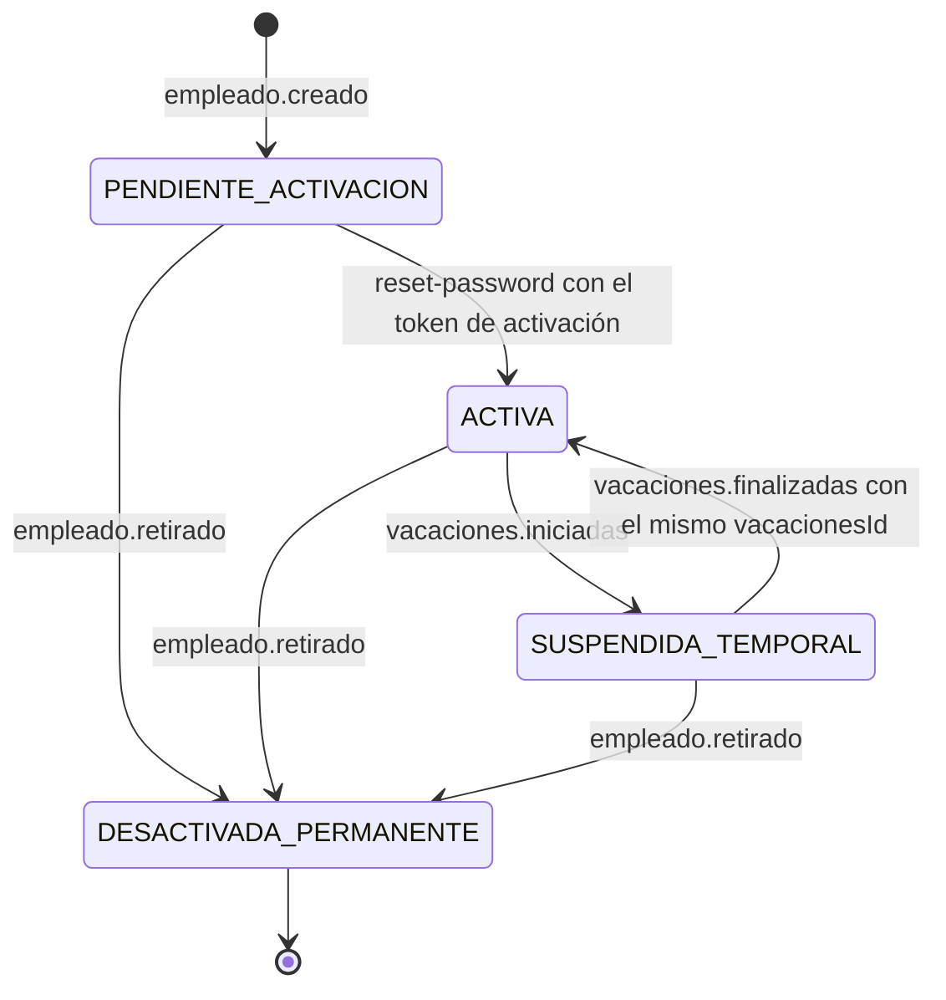
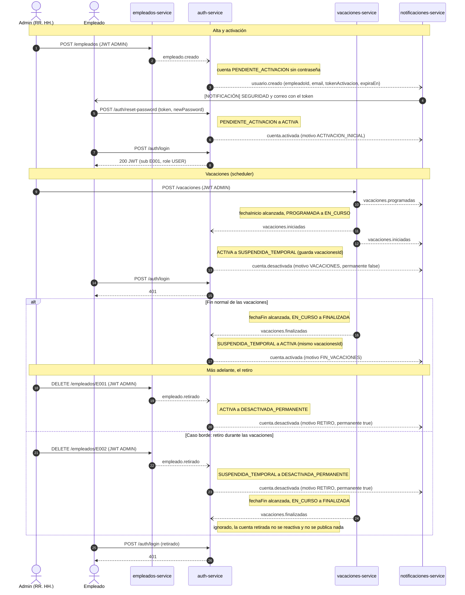

# TalentFlow

Sistema de onboarding y offboarding de empleados basado en una arquitectura orientada a microservicios.

## Arquitectura (Reto 5 — seguridad e identidad sobre eventos)

El sistema tiene un **único punto de entrada** (el API Gateway, Reto 3), **comunicación asincrónica** por eventos a través de un **message broker (RabbitMQ)** desde el Reto 4 y, desde el Reto 5, **autenticación y autorización**: el `auth-service` emite un JWT y el Gateway lo valida en cada petición antes de enrutarla (ver [Seguridad e identidad](#seguridad-e-identidad-reto-5)). Un solo evento — por ejemplo `empleado.creado` — dispara reacciones automáticas e independientes en varios servicios (*fan-out*), entre ellas la creación de la cuenta del empleado. Ningún microservicio ni base de datos publica puerto al host: solo el Gateway (`8080`) y dos UIs de herramientas: la de administración del broker (`15672`) y la de Mailhog (`8025`, correos), ver [por qué](#puertos-publicados-además-del-gateway).

```
                          Cliente HTTP (curl, Swagger UI, Bruno)
                                             │  única URL base · Authorization: Bearer <JWT>
                                             ▼
                  ┌────────────────────────────────────────────────────┐
                  │                 api-gateway  :8080                 │ ← único puerto de la API
                  │  valida el JWT (HS256) · ADMIN / USER / propiedad  │
                  └──────────────────────────┬─────────────────────────┘
     /auth       /empleados   /departamentos │  /perfiles   /notificaciones  /vacaciones
       ┌──────────────┬──────────────┬───────┴──────┬──────────────┬──────────────┐
       ▼              ▼              ▼              ▼              ▼              ▼
 auth-service     empleados    departamentos    perfiles    notificaciones   vacaciones
  :8086 (Go)    :8081 (Node)    :8082 (PHP)  :8083 (Python)   :8084 (Go)    :8085 (Java)
 firma el JWT                                                                + scheduler
       │              │                             │              │              │
  ┌────┴──────────────┴─────────────────────────────┴──────────────┴──────────────┴────────┐
  │  message-broker (RabbitMQ) — exchange topic "talentflow.eventos"                       │
  │  colas: auth.eventos · perfiles.eventos · notificaciones.eventos · vacaciones.eventos  │
  └────────────────────────────────────────────────────────────────────────────────────────┘
  publican: auth-service (usuario.*, cuenta.*) · empleados (empleado.*) · vacaciones (vacaciones.*)
  REST + Circuit Breaker (Reto 3): empleados-service → departamentos-service
  Cada servicio con su propia base de datos (nunca compartida):
  db-auth · db-empleados · db-perfiles · db-notificaciones · db-vacaciones (PostgreSQL 16)
  db-departamentos (MySQL 8.0)
```

### Servicios y lenguajes

El proyecto final exige al menos **4 lenguajes distintos**; el ecosistema ya tiene **5**. Los tres servicios del Reto 4 están en lenguajes distintos entre sí y distintos de los de empleados y departamentos, como exige el reto; el `auth-service` del Reto 5 está en Go:

| Servicio | Lenguaje / framework | Rol | Puerto interno | Base de datos propia |
|---|---|---|---|---|
| **api-gateway** | **Node.js** + Express + `http-proxy-middleware` | Punto de entrada único; **valida el JWT** y aplica la autorización (Reto 5) | 8080 (**publicado**) | — |
| auth-service | **Go** (`net/http`, `pgx`) | **Emite el JWT** (login y contraseñas) + **consume y produce** eventos del ciclo de la cuenta (Reto 5) | 8086 | PostgreSQL 16 |
| empleados-service | **Node.js** + Express | REST + **productor** de eventos | 8081 | PostgreSQL 16 |
| departamentos-service | **PHP** 8.2 (servidor nativo) | REST | 8082 | MySQL 8.0 |
| perfiles-service | **Python** 3.13 + FastAPI | **Consume** eventos + REST | 8083 | PostgreSQL 16 |
| notificaciones-service | **Go** 1.25 (`net/http`) | **Solo consume** eventos (puramente reactivo) | 8084 | PostgreSQL 16 |
| vacaciones-service | **Java** 17 + Spring Boot 3.5 | REST + **productor** de eventos (+ réplica por eventos) + **scheduler** de inicio y fin (Reto 5) | 8085 | PostgreSQL 16 |
| message-broker | RabbitMQ 3.13 (management) | Mensajería | 5672 interno · UI 15672 (**publicada**) | — |
| mailhog | Mailhog 1.0.1 | Servidor de correo de pruebas (bonus: correo real por SMTP) | 1025 interno · UI 8025 (**publicada**) | — (en memoria) |

Ningún servicio accede a la base de datos de otro: se comunican solo por **HTTP a través de su nombre en la red de Docker** (nunca `localhost` ni IPs fijas) o por **eventos**.

### El Gateway: por qué un Gateway de aplicación (no Nginx/Traefik)

Se evaluaron dos familias: un **enrutador declarativo** (Nginx, Traefik) y un **Gateway de aplicación** (código propio). Se eligió el segundo, en Node.js + Express + `http-proxy-middleware`, por la trayectoria del curso, no por preferencia entre sí:

- **Reto 5**: el Gateway debe validar el JWT y aplicar reglas de autorización — lógica que un enrutador declarativo sin plugins no puede ejecutar.
- **Reto 10**: debe validar tokens por JWKS y propagar la identidad como cabeceras a los servicios internos.
- **Proyecto final**: contempla componer respuestas combinando empleado + perfil, algo que requiere código, no solo enrutamiento.

Ninguna de las tres es natural en un enrutador declarativo. Traefik aparecerá recién en el Reto 11, como balanceador de carga delante de este mismo Gateway.

### Tabla de rutas del Gateway

Enrutamiento por prefijo, sin rutas adicionales en el Gateway. Desde el Reto 5, toda ruta exige `Authorization: Bearer <JWT>` salvo las públicas (`/health`, `POST /auth/login`, `/auth/recover-password`, `/auth/reset-password` y la documentación), ver [estrategia de validación](#estrategia-de-validación-en-el-gateway-y-no-en-cada-servicio). La documentación Swagger de cada servicio vive **dentro de su propio prefijo** (`/empleados/docs`, `/departamentos/docs`…), así que es alcanzable a través del Gateway sin agregarle rutas nuevas (ver [Documentación OpenAPI](#documentación-openapi-swagger)):

| Ruta externa | Servicio interno | Notas |
|---|---|---|
| `GET /health` | (el propio Gateway) | Salud propia del Gateway (no hace proxy) + estado de los 6 servicios, su base de datos, el Circuit Breaker y su conexión al broker; `problemas` explica por qué el sistema está `DEGRADADO` — ver [manual del Reto 4](docs/reto-04/README.md) |
| `/auth/*` | `http://auth-service:8086` | Reto 5: login, recuperación, restablecimiento y cambio de contraseña |
| `/empleados/*` | `http://empleados-service:8081` | Cuerpo, cabeceras y código de estado se reenvían sin alterar (salvo las cabeceras `X-User-*`, que pone el Gateway) |
| `/departamentos/*` | `http://departamentos-service:8082` | Ídem |
| `/perfiles/*` | `http://perfiles-service:8083` | Ídem (Reto 4) |
| `/notificaciones/*` | `http://notificaciones-service:8084` | Ídem (Reto 4) |
| `/vacaciones/*` | `http://vacaciones-service:8085` | Ídem (Reto 4) |
| cualquier otra ruta | — | `404` en JSON (`{"error", "message", "path"}`) del propio Gateway, no la página por defecto de Express |

**URL base del sistema (desde el Reto 3 en adelante): `http://localhost:8080`**

Si el servicio destino no responde (caído, timeout de conexión), el Gateway responde `503` con un cuerpo JSON descriptivo (`{"error", "message", "path"}`), nunca la página de error por defecto del framework proxy. Verificado: con `http-proxy-middleware@3`, el hook de error es `on: { error }`, no el `onError` plano de la v2 — con la sintaxis vieja el error nunca se intercepta y el cliente recibe un `504` en texto plano de la librería en vez del `503` JSON exigido.

## Estructura

```
TalentFlow/
├── microservicios/
│   ├── api-gateway/                   # Reto 3 (Node.js + Express) — único punto de entrada; valida el JWT (Reto 5)
│   ├── auth-service/                  # Reto 5 (Go + Postgres) — cuentas, JWT y ciclo de vida por eventos
│   ├── gestion-empleados/             # Retos 1-4 (Node.js + Postgres, Circuit Breaker, productor de eventos)
│   ├── gestion-departamentos/         # Reto 2 (PHP + MySQL)
│   ├── gestion-perfiles/              # Reto 4 (Python + FastAPI + Postgres) — consume eventos + REST
│   ├── notificaciones/                # Reto 4 (Go + Postgres) — solo consume eventos
│   └── gestion-vacaciones/            # Reto 4 (Java + Spring Boot + Postgres) — REST + productor de eventos
├── infra/rabbitmq/                    # Reto 4: topología de eventos (exchange, colas, bindings) + su importación
├── docs/                              # Manuales, evidencia y decisiones por reto (reto-03/, reto-04/, reto-05/, eventos.md…)
├── docker-compose.yml                 # Orquesta todo el sistema (un solo comando)
└── package.json                       # npm workspaces de los servicios Node (solo tooling de desarrollo)
```

> **Nota — no existe código compartido entre microservicios.** Hasta el Reto 1 existía un paquete `shared/` con el modelo de empleado y la clase de error, importado por `gestion-empleados`. Es un patrón de monolito (un "shared kernel" entre servicios) y se corrigió en el Reto 2: ese código ahora vive únicamente dentro de `microservicios/gestion-empleados/src/` (`errores.js` y `dominio/empleado.js`). Ningún microservicio importa código de negocio de otro ni de un paquete común — si dos servicios necesitan la misma validación, cada uno la implementa por su cuenta; la única comunicación permitida entre ellos es HTTP o eventos (desde el Reto 4). Por la misma razón, el envelope de los eventos está implementado por separado en cada servicio (cada uno en su lenguaje), fijado por el Catálogo de Eventos y verificado con pruebas. `package.json` en la raíz sigue usando `npm workspaces`, pero solo como conveniencia de desarrollo (instalar una vez, correr `npm test` en todos) — ninguna dependencia real cruza de un servicio a otro, y el `Dockerfile` de cada servicio no depende del código de ningún otro.

## Flujo de trabajo con ramas (Git)

> Esto es únicamente la **estructura de ramas en Git** del equipo, no una implementación de DevOps completa — todavía no hay integración continua (CI), despliegue automático ni entornos separados por rama. Esa parte se evaluará e implementará más adelante en el proyecto final, si el curso lo requiere.

| Rama | Rol |
|---|---|
| `main` | Producción. Siempre debe reflejar el sistema funcionando y evaluado. Nadie trabaja directo aquí: solo recibe merges desde `dev`. |
| `dev` | Integración. Rama base donde se junta el trabajo de todo el equipo antes de llegar a producción. |
| `Vale292005` | Rama personal de Vale. |
| `lyc4nthrope` | Rama personal de Cristhian. |

Flujo:

1. Cada integrante trabaja en su propia rama (la que lleva su usuario de GitHub) — nunca directo en `dev` ni en `main`.
2. Al terminar una funcionalidad, se abre un Pull Request de la rama personal hacia `dev`.
3. `dev` es donde se integra y se prueba el trabajo de todos junto.
4. Cuando `dev` está estable (`docker compose up --build` y `npm test` pasando), se hace un Pull Request de `dev` hacia `main`.

Antes de empezar a trabajar cada día, actualizar la rama personal desde `dev`:

```bash
git checkout dev
git pull origin dev
git checkout <tu-rama>
git merge dev
```

## Cómo levantar todo desde cero

Un solo comando, sin pasos manuales: el esquema de cada base de datos se crea desde su `init.sql` la primera vez que el volumen está vacío, y la topología del broker la importa `broker-init`. Levanta 16 contenedores (6 bases de datos, el broker, `broker-init`, que termina tras importar la topología, Mailhog, 6 servicios y el Gateway); tarda ~40 s en quedar todo `healthy` (`docker compose ps`).

```bash
docker compose up --build
```

Detener conservando los datos:

```bash
docker compose down
```

Detener y borrar también los volúmenes (reinicio total, útil si cambiaste el esquema en `init.sql`):

```bash
docker compose down -v
```

### Variables de entorno

`docker-compose.yml` define valores por defecto para desarrollo (usuarios, contraseñas y nombres de base de datos de las 6 bases, el usuario del broker y, desde el Reto 5, el secreto del JWT y el administrador semilla). Para un entorno propio: `cp .env.example .env` y ajustar los valores (`.env` no se versiona). Las credenciales nunca están escritas en el código, solo en variables de entorno; cada servicio arma sus URLs de conexión codificando usuario y contraseña.

**Secreto del JWT y administrador semilla (Reto 5).** `JWT_SECRET` se define una sola vez en `docker-compose.yml` y lo reciben `auth-service` y `api-gateway`; detalle en [Secreto del JWT](#secreto-del-jwt). `ADMIN_EMAIL` / `ADMIN_PASSWORD` crean al arrancar el administrador semilla (por defecto `admin@empresa.com` / `Admin123*`, valores académicos).

## Arranque ordenado — evidencia

`depends_on` por sí solo solo espera a que el *contenedor* arranque, no a que el servicio esté listo. Por eso cada base de datos tiene un `healthcheck` (`pg_isready` / `mysqladmin ping`), `departamentos-service` tiene el suyo propio (consulta su endpoint interno `GET /health`, que también verifica la conexión a MySQL), `empleados-service` también (su `GET /health` interno verifica Postgres) y usa `depends_on: condition: service_healthy` contra **ambos**: su base de datos y `departamentos-service` — esto se agregó porque el profesor señaló, revisando el Reto 2, que faltaba esa dependencia explícita. El Gateway tiene su propio `healthcheck` (su `/health`) y sigue con `depends_on` simple (sin `condition`) hacia los dos microservicios: si arranca antes de que alguno esté listo, sus peticiones fallan con el `503` descrito arriba hasta que el servicio responde — no se cae, se degrada. Desde el Reto 4, los servicios que publican o consumen eventos (empleados, perfiles, notificaciones, vacaciones) esperan además a `broker-init` (`condition: service_completed_successfully`): la topología de eventos existe antes del primer mensaje, así ningún evento se descarta por no tener cola. Cada servicio nuevo espera también a su propia base de datos (`service_healthy`) y tiene su `healthcheck`. Verificado en este repo, desde cero (`docker compose ps`):

```
SERVICE                   STATUS                    PORTS
api-gateway               Up (healthy)              0.0.0.0:8080->8080/tcp
database-auth             Up (healthy)              5432/tcp
database-departamentos    Up (healthy)              3306/tcp, 33060/tcp
database-empleados        Up (healthy)              5432/tcp
database-notificaciones   Up (healthy)              5432/tcp
database-perfiles         Up (healthy)              5432/tcp
database-vacaciones       Up (healthy)              5432/tcp
mailhog                   Up                        1025/tcp, 0.0.0.0:8025->8025/tcp
message-broker            Up (healthy)              0.0.0.0:15672->15672/tcp (+ puertos internos)
auth-service              Up (healthy)              8086/tcp
departamentos-service     Up (healthy)              8082/tcp
empleados-service         Up (healthy)              8081/tcp
notificaciones-service    Up (healthy)              8084/tcp
perfiles-service          Up (healthy)              8083/tcp
vacaciones-service        Up (healthy)              8085/tcp
```

Solo tres mapeos al host (`0.0.0.0:…`): el Gateway, la UI del broker y la UI de Mailhog. El resto son puertos internos. `mailhog` no tiene healthcheck (ningún servicio espera por él). `broker-init` no aparece porque terminó (`Exited (0)`) tras importar la topología.

## Persistencia de datos — evidencia

```bash
# 1. Destruir contenedores, conservando volúmenes
docker compose down
docker compose up -d
curl http://localhost:8080/empleados/E001
# → 200, el empleado sigue existiendo: los datos viven en el volumen, no en el contenedor

# 2. Destruir también los volúmenes
docker compose down -v
docker compose up -d --build
curl http://localhost:8080/empleados/E001
# → 404, el volumen se borró y con él los datos
```

Ambos casos se probaron manualmente sobre esta rama y se comportan como arriba.

## Documentación OpenAPI (Swagger)

Ningún servicio publica puerto al host, así que cada uno sirve su Swagger **bajo su propio prefijo**, que es lo único que enruta el Gateway (no se agregan rutas al Gateway). Desde el Reto 5 la documentación es una ruta pública, y cada especificación declara el esquema **`bearerAuth`** (HTTP bearer, JWT): botón **Authorize** → pegar el token (sin el prefijo `Bearer`). Salvo en empleados (`swagger-ui-express` sin opciones), `persistAuthorization` conserva el token al recargar la página. Cómo obtener el token: [abajo](#cómo-obtener-un-token-para-pruebas-locales).

| Servicio | Swagger UI | Especificación |
|---|---|---|
| auth-service | `http://localhost:8080/auth/docs` | `/auth/openapi.json` |
| empleados-service | `http://localhost:8080/empleados/docs` | `/empleados/openapi.json` |
| departamentos-service | `http://localhost:8080/departamentos/docs` | `/departamentos/openapi.json` |
| perfiles-service | `http://localhost:8080/perfiles/docs` | `/perfiles/openapi.json` |
| notificaciones-service | `http://localhost:8080/notificaciones/docs` | `/notificaciones/openapi.json` |
| vacaciones-service | `http://localhost:8080/vacaciones/docs` | `/vacaciones/openapi.json` |

Hasta el Reto 3 la documentación vivía en `/docs` (fuera del prefijo) y no era alcanzable desde fuera; se movió en el Reto 4 porque la rúbrica evalúa el funcionamiento de Swagger UI. Consecuencia aceptada: `docs` y `openapi.json` no pueden usarse como id de un recurso (p. ej. `GET /empleados/docs` es la documentación, no el empleado "docs").

## Comunicación asincrónica (Reto 4)

> Manual paso a paso, estados y pruebas: [`docs/reto-04/README.md`](docs/reto-04/README.md). Evidencia: [`docs/reto-04/pruebas.md`](docs/reto-04/pruebas.md). Decisiones y aprendizajes por fase: [`docs/reto-04/PLAN.md`](docs/reto-04/PLAN.md).

### Message broker: por qué RabbitMQ

Se evaluaron las cuatro opciones del reto frente a lo que este sistema necesita:

| Criterio (lo que exige el reto) | **RabbitMQ** ✅ | Apache Kafka | Redis Streams | NATS |
|---|---|---|---|---|
| Fan-out: un evento, varios consumidores independientes | Exchange *topic* + una cola por servicio: nativo | Grupos de consumidores por *topic*: nativo | Grupos de consumidores: sí | Sujetos + JetStream: sí |
| **Publicar un mensaje a mano desde la UI** (prueba de deduplicación exigida) | **Sí**: botón *Publish message* en la UI incluida | No en la UI estándar (herramientas externas) | No tiene UI de administración propia | No tiene UI de administración propia |
| UI de administración (el reto pide configurarla) | Incluida (`rabbitmq:3-management`) | Externa (Kafka UI, AKHQ…) | Externa (RedisInsight) | Externa |
| Operación en un `docker-compose` de desarrollo | 1 contenedor liviano | Broker + KRaft/ZooKeeper, más memoria | 1 contenedor | 1 contenedor |
| Confirmaciones al publicar y *ack* manual al consumir | Sí (*publisher confirms*, `ack`/`nack` por mensaje) | Sí (acks + commit de offsets) | Sí (`XACK`) | Sí (JetStream) |
| Cuándo brilla | Mensajería entre servicios, enrutamiento flexible | Streaming de alto volumen, retención y *replay* | Si ya se usa Redis | Latencia mínima, cloud-native |

**Decisión:** RabbitMQ. Resuelve el fan-out de forma nativa (un exchange *topic* enruta cada evento a la cola de cada servicio suscrito), su UI trae la publicación manual que el reto exige para demostrar la deduplicación, y es un solo contenedor. Kafka queda sobredimensionado: su fortaleza (streaming masivo con retención y *replay*) no es un requisito aquí, y exige operar más infraestructura. Redis Streams y NATS carecen de una UI de administración integrada. Además, agregar un consumidor nuevo (el `auth-service` del Reto 5) es solo crear su cola y sus *bindings*: el productor no cambia.

### Topología

| Elemento | Valor |
|---|---|
| Exchange | `talentflow.eventos`, tipo **topic**, durable. **Routing key = `type` del evento** |
| Cola `notificaciones.eventos` | `empleado.creado`, `empleado.retirado`, `vacaciones.programadas` |
| Cola `perfiles.eventos` | `empleado.creado`, `empleado.actualizado`, `empleado.retirado` |
| Cola `vacaciones.eventos` | `empleado.creado`, `empleado.actualizado`, `empleado.retirado` (réplica local) |

> **Reto 5:** se agregó la cola `auth.eventos` y cambiaron los *bindings* de `notificaciones.eventos`; la topología vigente está en [Seguridad e identidad → eventos](#eventos-del-reto-5).

Colas durables y mensajes persistentes: sobreviven a reinicios del broker. La topología es código versionado ([`infra/rabbitmq/definitions.json`](infra/rabbitmq/definitions.json)) y la importa el contenedor de un solo uso **`broker-init`** por la API de administración, antes de que arranque cualquier productor o consumidor (`depends_on: condition: service_completed_successfully`). No se usa `load_definitions` al arrancar el broker porque, en ese modo, RabbitMQ **no crea el usuario por defecto** y habría que versionar credenciales dentro del JSON.

#### Puertos publicados además del Gateway

El puerto AMQP (`5672`) es **interno** (`expose`): solo lo usan los servicios, dentro de la red de Docker. Se publica únicamente la **UI de administración** (`15672`), porque el reto exige usarla (verificar que el broker está activo y publicar mensajes a mano para la prueba de deduplicación). Credenciales por variables de entorno (`RABBITMQ_USER` / `RABBITMQ_PASS`, ver `.env.example`).

La otra excepción es **Mailhog** (bonus del reto: correo real por SMTP), por la misma razón: su UI (`8025`) es una herramienta de pruebas para ver los correos enviados, no un microservicio de negocio ni parte de la API. Su puerto SMTP (`1025`) es **interno**: solo lo usa notificaciones-service dentro de la red de Docker. Los correos no salen a ningún buzón real.

### Eventos implementados (Catálogo de Eventos)

Nombres, envelope y cargas útiles **idénticos** al Catálogo de Eventos (no se inventó ni renombró ningún campo; hay pruebas que lo verifican campo por campo). Detalle en [`docs/eventos.md`](docs/eventos.md).

```json
{ "id": "3f9b2c10-…", "type": "empleado.creado", "version": 1,
  "occurredAt": "2026-03-01T14:32:05Z", "producer": "empleados-service", "data": { … } }
```

| Evento (Catálogo) | Productor | Cuándo | Consumidores y reacción |
|---|---|---|---|
| `empleado.creado` (3.1) | empleados-service | `POST /empleados` exitoso | perfiles: crea el perfil por defecto · notificaciones: BIENVENIDA · vacaciones: registra al empleado en su réplica |
| `empleado.actualizado` (3.2) | empleados-service | `PUT /empleados/{id}` exitoso | perfiles: sincroniza nombre y email · vacaciones: actualiza el email de la réplica |
| `empleado.retirado` (3.3) | empleados-service | `DELETE /empleados/{id}` (baja lógica) | perfiles: archiva el perfil · notificaciones: DESVINCULACION · vacaciones: marca al empleado como retirado |
| `vacaciones.programadas` (3.8) | vacaciones-service | `POST /vacaciones` exitoso | notificaciones: VACACIONES (confirmación del período) |

**Publicación.** El evento se publica **después** de que la operación en la base de datos fue exitosa, con **confirmación del broker** (*publisher confirms*: "publicado" significa que RabbitMQ lo aceptó) y un tiempo máximo de espera. Si la publicación falla, se **registra el error y la operación no se revierte**, como exige el reto: la petición responde igual con éxito.

**Bienvenida y despedida.** El Catálogo de Eventos (y el Reto 5) disparan el correo de bienvenida con `usuario.creado` y el de despedida con `cuenta.desactivada`, porque son los que traen el token de activación o el motivo. Esos eventos los produce el `auth-service` del Reto 5, que todavía no existe; por eso aquí se aplica lo que pide el Reto 4: BIENVENIDA con `empleado.creado` y DESVINCULACION con `empleado.retirado`. En `notificaciones-service` es un mapa evento → notificación: cambiarlo en el Reto 5 no toca el resto del servicio. **Hecho en el Reto 5:** la bienvenida sale de `usuario.creado` y la despedida de `cuenta.desactivada`.

### Deduplicación (obligatoria)

Cada consumidor tiene su tabla `eventos_procesados(id, procesado_en)` y aplica esta regla:

1. Registra el `id` del mensaje **y** aplica el efecto **en una sola transacción** de base de datos: o quedan ambos, o ninguno. (Si fueran pasos separados, una caída entre ellos dejaría un evento "procesado" sin efecto, o un efecto que se repetiría.)
2. Si el `id` ya existía, el mensaje es un **duplicado**: no se repite el efecto y se confirma igual.
3. El mensaje se confirma al broker (`ack`) **solo después del commit**. Si el servicio muere antes, RabbitMQ lo reentrega y el paso 2 evita el doble efecto.

Además, cada consumidor distingue **qué hacer con un fallo** (para no caer en el antipatrón del reintento infinito): un mensaje corrupto, de un tipo que no consume o con datos que la base rechaza **nunca** podrá procesarse → se descarta y queda en el log (la cola de mensajes muertos, DLQ, llega en el Reto 29); un fallo **transitorio** (su base de datos caída) → el mensaje vuelve a la cola tras una espera y se procesa cuando la base regresa, sin perderse.

**Evidencia** ([`docs/reto-04/pruebas.md`](docs/reto-04/pruebas.md), paso 9): el mismo `empleado.creado` publicado **dos veces** con el mismo `id` produce **una sola notificación y un solo perfil**, y los tres consumidores registran "evento duplicado descartado". Cómo repetirlo desde la UI: [manual, §5](docs/reto-04/README.md#5-deduplicación-desde-la-ui-de-rabbitmq).

### Servicios nuevos

| Servicio | Endpoints | Qué hace |
|---|---|---|
| **perfiles-service** (Python) | `GET /perfiles`, `GET /perfiles/{empleadoId}`, `PUT /perfiles/{empleadoId}` | Crea el perfil por defecto al consumir `empleado.creado` (`nombre` = nombre completo, resto vacío), sincroniza nombre y email con `empleado.actualizado` y lo **archiva** (no lo borra) con `empleado.retirado`. `PUT` es **parcial** (el propio reto envía solo algunos campos) y solo acepta los campos del perfil: `nombre`/`email` los replica empleados → `400`; perfil archivado → `409`; inexistente → `404`. Si llega `empleado.actualizado` de un empleado sin perfil (su `empleado.creado` se perdió), lo crea: el sistema se recupera solo |
| **notificaciones-service** (Go) | `GET /notificaciones`, `GET /notificaciones/{empleadoId}` | Puramente reactivo: ningún servicio lo llama por REST. Consume `empleado.creado`, `empleado.retirado` y `vacaciones.programadas`, simula el envío con el log `[NOTIFICACIÓN] Tipo: … \| Para: … \| Mensaje: "…"` y guarda el historial `{id, tipo, destinatario, mensaje, fechaEnvio, empleadoId}`. **Bonus:** además envía cada notificación como correo real por SMTP a Mailhog (`http://localhost:8025`); si el correo falla, se registra el error y la notificación queda guardada |
| **vacaciones-service** (Java) | `POST /vacaciones`, `GET /vacaciones`, `GET /vacaciones?empleadoId=`, `GET /vacaciones/{id}`, `DELETE /vacaciones/{id}` | Programa períodos (`V-2026-0042`, estado `PROGRAMADA`) y publica `vacaciones.programadas`. `DELETE` **cancela** (estado `CANCELADA`, no borra) solo si aún no ha iniciado; si ya inició o no está programado → `409` |

**Validaciones de vacaciones** (todas `400` con mensaje descriptivo):

1. **Fechas incoherentes**: `fechaFin` debe ser **posterior** a `fechaInicio` (el mismo día no lo es).
2. **Fechas en el pasado**: `fechaInicio` anterior a **hoy** en `America/Bogota` (hoy es válido).
3. **Solapamiento** con otro período `PROGRAMADA` o `EN_CURSO` del empleado: la respuesta incluye `periodoEnConflicto`. Garantizado también ante solicitudes **simultáneas**: bloqueo de la fila del empleado (`SELECT … FOR UPDATE`) + restricción `EXCLUDE USING gist` en PostgreSQL (la misma "doble garantía" que la unicidad del email en el Reto 2). Verificado: 10 solicitudes simultáneas → 1 creada, 9 rechazadas.
4. **Empleado inexistente** (o retirado).

`diasHabiles` (campo de `vacaciones.programadas`): lunes a viernes, ambos extremos incluidos, sin festivos. (El ejemplo del catálogo — 12 días del 15 al 30 de marzo de 2026 — no coincide con ninguna regla estándar: de lunes a viernes son 11.)

### Validación del empleado en vacaciones: réplica local por eventos (opción b)

El reto plantea dos opciones y pide justificar la elegida:

| | (a) Consulta REST a empleados-service | **(b) Réplica local por eventos** ✅ |
|---|---|---|
| Cómo | `GET /empleados/{id}` en cada solicitud, como el Reto 2 con departamentos | vacaciones-service consume `empleado.creado`/`actualizado`/`retirado` y mantiene su tabla `empleados_replica` |
| Si empleados-service está caído | **No se pueden programar vacaciones** (acoplamiento temporal) | **Sigue funcionando** |
| Consistencia | Inmediata | **Eventual**: un empleado recién creado tarda milisegundos en aparecer en la réplica |
| Complejidad | Baja | Mayor: un consumidor más, con deduplicación |

**Elegimos (b): disponibilidad sobre consistencia inmediata.** Es la misma decisión de negocio que el fallback `PENDIENTE` del Reto 3: RR. HH. no debe quedar bloqueado por la caída de otro servicio. Dos razones más la inclinan: el evento `vacaciones.programadas` exige el **email** del empleado (con la opción (a) serían dos dependencias síncronas por solicitud; la réplica ya lo tiene), y la réplica también sabe si el empleado fue **retirado**, así que un retirado no puede programar vacaciones. El costo — la ventana de consistencia eventual — se acepta porque la réplica se actualiza en milisegundos y es visible en los logs.

### Baja lógica y auditoría (empleados-service)

- `PUT /empleados/{id}`: modifica **solo** los campos que replica `empleado.actualizado` (`nombre`, `apellido`, `email`, `cargo`, `area`, `departamentoId`); un campo desconocido o de solo lectura modificado → `400` (evita la asignación masiva). Publica `empleado.actualizado`.
- `DELETE /empleados/{id}`: **no borra**. Cambia `estado` a `RETIRADO` y guarda `fechaRetiro` (instante UTC) y `motivoRetiro` (cuerpo opcional `{"motivo": …}`: `RENUNCIA` por defecto, `DESPIDO`, `JUBILACION`, `FIN_CONTRATO` u `OTRO`; el catálogo exige un `motivo` en `empleado.retirado`). Publica `empleado.retirado`. Es atómico: dos `DELETE` simultáneos → uno gana, el otro recibe `409`, y se publica **un** evento. Una restricción en la base de datos garantiza que `RETIRADO` ⇔ tiene fecha y motivo.
- Auditoría: `GET /empleados?estado=RETIRADO` y `GET /empleados?estado=RETIRADO&desde=2026-01-01&hasta=2026-06-30` (rango inclusivo sobre el **día** del retiro en `America/Bogota`: un retiro a las 21:00 en Bogotá es el día siguiente en UTC).

### Limitaciones conocidas

- **Evento perdido si el broker está caído al publicar.** La operación se guarda y el evento se descarta con un error en el log (lo que pide el reto: no revertir). La solución formal es el patrón **Outbox** (guardar el evento en la misma transacción y publicarlo después), fuera del alcance de este reto. perfiles-service mitiga el caso más visible: un `empleado.actualizado` posterior recrea el perfil faltante.
- **Vacaciones futuras de un empleado retirado** siguen `PROGRAMADA`: el reto no pide cancelarlas y el catálogo no define un evento de cancelación. El caso "retiro durante vacaciones" lo resuelve el Reto 5 ([caso borde](#evidencia-del-caso-borde-retiro-durante-las-vacaciones)).
- **Un empleado que la reconciliación del Reto 3 marca `RECHAZADO`** no genera evento: el catálogo no define uno.
- **Correo no enviado si el servidor SMTP está caído** (bonus): el error queda en el log y no se reintenta, porque reencolar el mensaje podría duplicar correos. La notificación sí queda en el historial.

### Cómo probar el flujo asincrónico

```bash
docker compose down -v && docker compose up --build -d   # volúmenes limpios
bash docs/reto-04/demo.sh                                 # los 11 pasos de la sección 6 del reto + correos del bonus
cd docs/reto-04/bruno && npx @usebruno/cli run --env Local  # colección: 21 peticiones con tests
```

Paso a paso manual, dónde ver el estado de cada componente y problemas comunes: [`docs/reto-04/README.md`](docs/reto-04/README.md).

## Seguridad e identidad (Reto 5)

> Manual paso a paso, estado de cada componente y preguntas de la sustentación: [`docs/reto-05/README.md`](docs/reto-05/README.md). Evidencia de los 18 pasos del PDF: [`docs/reto-05/pruebas.md`](docs/reto-05/pruebas.md). Decisiones (D1-D23) y aprendizajes por fase: [`docs/reto-05/PLAN.md`](docs/reto-05/PLAN.md). Detalle del servicio: [`microservicios/auth-service/README.md`](microservicios/auth-service/README.md).

### auth-service

Servicio nuevo en **Go** con su propia base de datos (`db-auth`, PostgreSQL), solo alcanzable a través del Gateway (`expose: 8086`). **No hay registro público**: la cuenta de cada empleado nace del evento `empleado.creado`.

| Endpoint | Acceso | Qué hace | Respuestas |
|---|---|---|---|
| `POST /auth/login` | público | `{email, password}` → `{token, tipo: "Bearer"}`; solo cuentas `ACTIVA` | 200 · 401 |
| `POST /auth/recover-password` | público | `{email}` → publica `usuario.recuperacion` con un token nuevo (el anterior deja de servir) | **202 siempre**, exista o no la cuenta (no revela qué emails existen) |
| `POST /auth/reset-password` | público | `{token, newPassword}` con un token de activación o de recuperación | 200 · 400 política · 401 token inválido, vencido o ya usado |
| `POST /auth/change-password` | con JWT (USER o ADMIN) | `{currentPassword, newPassword}` | 200 · 400 · 401 |

- **Token de acceso**: JWT **HS256** con `sub` (el `empleadoId`, o `admin` para el administrador semilla), `role` (`ADMIN` \| `USER`), `email`, `iss`, `iat` y `exp`. Vence a la hora (`JWT_VIGENCIA=1h`).
- **Tokens de activación y recuperación**: UUID aleatorio de **un solo uso**; solo se guarda su hash SHA-256. Vencen a las 24 h (`TOKEN_ACTIVACION_VIGENCIA`) y a la hora (`TOKEN_RECUPERACION_VIGENCIA`).
- **Contraseñas**: de 8 a 72 caracteres, con al menos una mayúscula, una minúscula y un dígito; guardadas con bcrypt.

### Cómo obtener un token para pruebas locales

**1. Administrador semilla (rol `ADMIN`).** Se crea al arrancar `auth-service` desde `ADMIN_EMAIL` / `ADMIN_PASSWORD` (por defecto `admin@empresa.com` / `Admin123*`, valores académicos de `docker-compose.yml`; se cambian en `.env`). Su contraseña nunca se escribe en el log.

```bash
curl -s -X POST http://localhost:8080/auth/login -H "Content-Type: application/json" \
  -d '{"email": "admin@empresa.com", "password": "Admin123*"}'
# {"tipo":"Bearer","token":"eyJhbGciOiJIUzI1NiIsInR5cCI6IkpXVCJ9…"}

# Guardarlo en una variable para las siguientes peticiones:
TOKEN_ADMIN=$(curl -s -X POST http://localhost:8080/auth/login -H "Content-Type: application/json" \
  -d '{"email": "admin@empresa.com", "password": "Admin123*"}' | python3 -c 'import json,sys; print(json.load(sys.stdin)["token"])')
```

**2. Un empleado (rol `USER`).** El ADMIN crea al empleado; su cuenta queda `PENDIENTE_ACTIVACION`, sin contraseña, y el token de activación llega por la notificación:

```bash
# a. Crear el empleado (el departamento IT debe existir: POST /departamentos con el mismo token)
curl -X POST http://localhost:8080/empleados -H "Authorization: Bearer $TOKEN_ADMIN" -H "Content-Type: application/json" \
  -d '{"id": "E001", "nombre": "Juan", "apellido": "Pérez", "email": "juan.perez@empresa.com",
       "numeroEmpleado": "EMP-2026-001", "cargo": "Desarrollador Senior", "area": "Tecnología",
       "departamentoId": "IT", "fechaIngreso": "2026-03-01"}'

# b. Leer el token de activación en el log de la notificación (o en Mailhog, http://localhost:8025,
#    correo "Bienvenido a TalentFlow: active su cuenta")
docker compose logs notificaciones-service | grep "Para: juan.perez@empresa.com"
# [NOTIFICACIÓN] Tipo: SEGURIDAD | Para: juan.perez@empresa.com | Mensaje: "Para establecer o recuperar
#   su contraseña use el token bb10c579-a668-49e9-… (vence …). Bienvenido a TalentFlow."

# c. Establecer la contraseña: la cuenta pasa a ACTIVA
curl -X POST http://localhost:8080/auth/reset-password -H "Content-Type: application/json" \
  -d '{"token": "<token del paso b>", "newPassword": "Inicial123"}'

# d. Login: JWT con role USER y sub = E001
curl -X POST http://localhost:8080/auth/login -H "Content-Type: application/json" \
  -d '{"email": "juan.perez@empresa.com", "password": "Inicial123"}'
```

`GET /notificaciones` muestra el token **enmascarado** (`****f488`) a propósito: cualquier USER puede leer ese historial, así que el token completo solo viaja en el log `[NOTIFICACIÓN]` y en el correo.

**3. Usar el token.**

- **curl**: `-H "Authorization: Bearer $TOKEN_ADMIN"`.
- **Swagger UI**: en `http://localhost:8080/auth/docs`, *Try it out* sobre `POST /auth/login` y copiar `token`. En el Swagger de cualquier servicio (`/empleados/docs`, `/vacaciones/docs`…), botón **Authorize** → pegar el token **sin** el prefijo `Bearer` (el esquema `bearerAuth` lo agrega). La documentación es pública; las operaciones protegidas responden 401 hasta autorizar.
- **Bruno**: abrir la carpeta [`docs/reto-05/bruno/`](docs/reto-05/bruno/) y elegir el entorno **Local** (`baseUrl`, `mailhogUrl`, `adminEmail`, `adminPassword`). La petición *Paso 02 - Auth - login del administrador semilla* guarda el JWT en `adminToken`; las del paso 5 toman el token de activación del correo que recibió Mailhog y la del paso 6 guarda el JWT del empleado en `userToken`. Cada petición protegida usa *Auth → Bearer Token* con esas variables. Por línea de comandos: `cd docs/reto-05/bruno && npx @usebruno/cli run --env Local`.

### Estrategia de validación: en el Gateway y no en cada servicio

Se eligió **validar el token en el Gateway** (opción 1 del PDF) en lugar de interceptores en cada servicio. Cada petición pasa, en orden, por ([`api-gateway/app.js`](microservicios/api-gateway/app.js)):

1. **Se borran** las cabeceras `X-User-Id`, `X-User-Role` y `X-User-Email` que envíe el cliente (D10): nadie puede hacerse pasar por otro usuario poniéndolas a mano.
2. La ruta se analiza segmento a segmento: los trucos de codificación que un servicio podría interpretar distinto (`%2F`, `%2E%2E`, `//`, `;`…) → **400**; una ruta fuera de los 6 prefijos → **404**.
3. Si la ruta es **pública** (D9), se reenvía sin token.
4. Sin `Authorization: Bearer` → **401** *"Token requerido para acceder a este recurso."*. Firma, emisor (`iss` = `JWT_ISSUER`) o `exp` inválidos → **401** *"Token inválido o expirado."*. Solo se acepta HS256 y el `exp` es obligatorio.
5. La **matriz de autorización** (D8) decide; si el rol no alcanza → **403** *"No tiene permisos para realizar esta acción."*.
6. Se agregan las cabeceras `X-User-*` verificadas y se reenvía al servicio.

| Petición | Sin token | `USER` | `ADMIN` |
|---|---|---|---|
| `GET /health`, `POST /auth/login`, `POST /auth/recover-password`, `POST /auth/reset-password`, `GET /<servicio>/docs` y `/<servicio>/openapi.json` | ✅ pública | ✅ | ✅ |
| `GET` / `HEAD` de cualquier recurso | 401 | ✅ | ✅ |
| `POST /auth/change-password` | 401 | ✅ | ✅ |
| `PUT /perfiles/{empleadoId}` | 401 | ✅ solo si `empleadoId` = su `sub` (**propiedad**); ajeno → 403 | ✅ |
| Cualquier otra escritura (`POST`, `PUT`, `DELETE`…) | 401 | 403 | ✅ |

**401 frente a 403.** 401 = el sistema **no sabe quién es** el cliente: sin token, token inválido o vencido, o (en el login) credenciales incorrectas o una cuenta que no está `ACTIVA`. 403 = **sabe quién es, pero no puede** hacer eso: USER que intenta escribir, o editar el perfil de otro.

**Por qué en el Gateway:**

- **Un solo lugar para una regla de seguridad.** Hay seis servicios en cinco lenguajes: con interceptores serían seis implementaciones de la validación del JWT y seis copias de la matriz que deben coincidir siempre; una que diverja es un agujero. En el Gateway hay una sola, con pruebas de la matriz completa (401 / 403 / 200 y propiedad).
- **Los servicios del Reto 4 no cambian**: reciben la petición ya autorizada.
- **La propiedad se resuelve con la ruta**: `PUT /perfiles/{empleadoId}` se compara con el `sub` del token sin consultar a ningún servicio.
- Es la trayectoria prevista desde el Reto 3 ([por qué un Gateway de aplicación](#el-gateway-por-qué-un-gateway-de-aplicación-no-nginxtraefik)): en el Reto 10 el Gateway validará por JWKS y propagará la identidad.

**Lo que cuesta (aceptado y documentado):**

- **Los servicios confían en la red interna**: no validan el token. Quien llegue a un servicio dentro de la red de Docker se salta la autorización. Lo mitiga que ningún servicio publica puerto (`expose`, solo el Gateway en `8080`); la defensa en profundidad (validar también en cada servicio con la clave pública, JWKS) llega con el Reto 10.
- **Las cabeceras `X-User-*` se propagan, pero hoy ningún servicio las lee**: quedan listas para cuando un servicio necesite la identidad (p. ej. auditoría de quién hizo el cambio).
- **El Gateway conoce la forma de algunas rutas de dominio** (`/perfiles/{empleadoId}`). Una regla de propiedad que dependa de datos guardados (p. ej. "solo sus propias vacaciones por id de período") no se puede resolver solo con la ruta y tendría que vivir en el servicio.
- **El JWT es *stateless***: suspender, retirar o cambiar la contraseña no invalida un JWT ya emitido; sigue valiendo hasta su `exp` (como máximo `JWT_VIGENCIA`, 1 h). Comprobado: tras retirar a un empleado su login responde 401, pero un JWT obtenido antes sigue leyendo (`GET` 200) hasta vencer. Lo acota la vigencia corta; revocarlo exigiría una lista de revocación o consultar el estado de la cuenta en cada petición (fuera del alcance del reto).
- **Excepción**: `auth-service` valida él mismo el JWT en `POST /auth/change-password` (necesita el `sub` para saber de quién es la contraseña). Por eso también recibe el secreto.

### Secreto del JWT

- **Algoritmo**: HS256 (HMAC-SHA256), clave simétrica, como permite el PDF: la misma clave firma (`auth-service`) y valida (`api-gateway`, y `auth-service` en el cambio de contraseña).
- **Dónde se define**: una sola vez, en el ancla `x-jwt` al comienzo de [`docker-compose.yml`](docker-compose.yml), que `auth-service` y `api-gateway` incluyen con `<<: *jwt` (D21). Así firmante y validador nunca quedan con valores distintos:

  ```yaml
  x-jwt: &jwt
    JWT_SECRET: ${JWT_SECRET:-talentflow_super_secret_2026}
    JWT_ISSUER: ${JWT_ISSUER:-auth-service}
  ```

- **Valor académico**: `talentflow_super_secret_2026`, documentado también en [`.env.example`](.env.example) (`JWT_SECRET=talentflow_super_secret_2026`). Está en Compose para que `docker compose up --build` funcione en un clon nuevo sin pasos manuales. Para cambiarlo basta con definir `JWT_SECRET` en `.env`, y ambos servicios toman el nuevo valor; una variable ausente o vacía en `.env` toma el valor académico.
- **Sin valor por defecto en el código** (D11): el Gateway ([`index.js`](microservicios/api-gateway/index.js)) y `auth-service` ([`config/config.go`](microservicios/auth-service/config/config.go)) no arrancan si `JWT_SECRET` falta o tiene solo espacios.
- **Límites conocidos**: el valor queda a la vista en Compose (sacarlo a un gestor de secretos es el Reto 9); y con clave simétrica quien valida también podría firmar. Con JWKS (Reto 10) `auth-service` firmará con su clave privada y los demás validarán con la pública.

### Ciclo de vida de la cuenta

Cuatro estados (D3), no un booleano: el PDF exige distinguir la suspensión temporal de la baja permanente.

| Estado | Cómo se llega | ¿Puede iniciar sesión? |
|---|---|---|
| `PENDIENTE_ACTIVACION` | `empleado.creado`: cuenta sin contraseña + token de activación | No |
| `ACTIVA` | `reset-password` con el token de activación; fin de las vacaciones que la suspendieron; el administrador semilla nace así | Sí |
| `SUSPENDIDA_TEMPORAL` | `vacaciones.iniciadas` sobre una cuenta `ACTIVA` (recuerda el `vacacionesId`, D18) | No (401) |
| `DESACTIVADA_PERMANENTE` | `empleado.retirado`, desde cualquier estado; se borra el token pendiente | No (401), nunca se reactiva |



Restablecer o cambiar la contraseña **nunca** saca a una cuenta de `SUSPENDIDA_TEMPORAL` o `DESACTIVADA_PERMANENTE`. Una cuenta pendiente no se suspende (no tiene nada que suspender, D19).

**Diagrama de secuencia**, desde `empleado.creado` hasta el retiro. Las flechas punteadas con punta abierta son eventos que viajan por RabbitMQ (exchange `talentflow.eventos`); las continuas son peticiones HTTP, que pasan todas por el Gateway (se omite para no recargar el diagrama), y las punteadas con punta llena, sus respuestas.



#### Eventos del Reto 5

Nombres y cargas útiles **idénticos** al Catálogo de Eventos (secciones 3.4 a 3.10), con el mismo envelope del Reto 4 (`id` UUID). Las fechas de vacaciones viajan en ISO-8601 con desfase (`2026-10-20T08:00:00-05:00`), una desviación documentada del catálogo (D6).

| Evento | Productor | Cuándo | `data` | Consumidores y reacción |
|---|---|---|---|---|
| `usuario.creado` (3.4) | auth-service | Cuenta creada desde `empleado.creado` | `empleadoId, email, tokenActivacion, expiraEn` | notificaciones: `SEGURIDAD` (bienvenida con el token) |
| `usuario.recuperacion` (3.5) | auth-service | `POST /auth/recover-password` de una cuenta existente y no retirada | `email, tokenRecuperacion, expiraEn` | notificaciones: `SEGURIDAD` |
| `cuenta.activada` (3.6) | auth-service | Activación inicial o fin de las vacaciones | `empleadoId, email, motivo` (`ACTIVACION_INICIAL` \| `FIN_VACACIONES`) | notificaciones: `CUENTA` ("Bienvenido de regreso…" con `FIN_VACACIONES`) |
| `cuenta.desactivada` (3.7) | auth-service | Suspensión por vacaciones o retiro | `empleadoId, email, motivo, permanente` (`VACACIONES`/`false` \| `RETIRO`/`true`) | notificaciones: `CUENTA` |
| `vacaciones.iniciadas` (3.9) | vacaciones-service (scheduler) | `PROGRAMADA` → `EN_CURSO` | `vacacionesId, empleadoId, email, fechaInicio, fechaFin` | auth: suspende · notificaciones: `VACACIONES` |
| `vacaciones.finalizadas` (3.10) | vacaciones-service (scheduler) | `EN_CURSO` → `FINALIZADA` | `vacacionesId, empleadoId, email, fechaFin` | auth: reactiva solo si corresponde |

Colas nuevas o cambiadas ([`definitions.json`](infra/rabbitmq/definitions.json)): **`auth.eventos`** ← `empleado.creado`, `empleado.retirado`, `vacaciones.iniciadas`, `vacaciones.finalizadas`; **`notificaciones.eventos`** ← `usuario.creado`, `usuario.recuperacion`, `cuenta.activada`, `cuenta.desactivada`, `vacaciones.programadas`, `vacaciones.iniciadas` (ya no `empleado.creado` ni `empleado.retirado`: la bienvenida sale de `usuario.creado`, que trae el token). `auth-service` aplica la misma [deduplicación](#deduplicación-obligatoria) que los consumidores del Reto 4, publica **después del commit y solo si el estado cambió**, y consume con *prefetch* 1 para que un mensaje reencolado no se procese después de los siguientes.

### Scheduler de vacaciones

- **Mecanismo**: Spring `@Scheduled` (`@EnableScheduling` en `VacacionesApplication`), en [`VacacionesScheduler.java`](microservicios/gestion-vacaciones/src/main/java/com/talentflow/vacaciones/infraestructura/scheduler/VacacionesScheduler.java): `@Scheduled(cron = "${vacaciones.cron}", zone = "${vacaciones.zona-horaria}")`. Sin infraestructura adicional: corre dentro del mismo proceso del servicio.
- **Frecuencia**: **cada minuto, en el segundo 0** (`0 * * * * *`).
- **Configuración** ([`application.yml`](microservicios/gestion-vacaciones/src/main/resources/application.yml)): `VACACIONES_CRON` (cron de Spring de 6 campos: seg min hora día mes día-semana; `-` lo desactiva), configurable en `.env`; `ZONA_HORARIA` (`America/Bogota`, fijada en `docker-compose.yml`), en la que se interpretan el cron y las fechas.
- **Qué hace cada pasada** (D7, [`ProcesadorCicloVacaciones.java`](microservicios/gestion-vacaciones/src/main/java/com/talentflow/vacaciones/aplicacion/ProcesadorCicloVacaciones.java)):
  1. `PROGRAMADA` con `fechaInicio <= ahora` → `EN_CURSO` y publica `vacaciones.iniciadas`.
  2. `EN_CURSO` con `fechaFin <= ahora` → `FINALIZADA` y publica `vacaciones.finalizadas`.

  Cada período va en su propia transacción con un `UPDATE … WHERE estado = <esperado>`, y el evento se publica después del commit. Un período que falla no detiene a los demás y se reintenta en la siguiente pasada; el job nunca deja escapar una excepción. Un evento sale, como mucho, un intervalo del cron después de la fecha.

**Cómo se demuestra sin esperar días reales.** Estrategia 2 del PDF: las fechas llevan **hora** (D6, `YYYY-MM-DDTHH:mm[:ss]` en `America/Bogota`), así que basta con programar un período que empiece y termine en unos minutos; no hacen falta endpoints para "forzar" el inicio:

```bash
curl -X POST http://localhost:8080/vacaciones -H "Authorization: Bearer $TOKEN_ADMIN" -H "Content-Type: application/json" \
  -d "{\"empleadoId\": \"E001\",
       \"fechaInicio\": \"$(TZ=America/Bogota date -d '+2 min' +%FT%H:%M:00)\",
       \"fechaFin\": \"$(TZ=America/Bogota date -d '+4 min' +%FT%H:%M:00)\"}"
# a los ~2 min: EN_CURSO, vacaciones.iniciadas, cuenta suspendida; a los ~4 min: FINALIZADA y reactivada
```

`demo.sh` hace exactamente esto: inicio en el próximo minuto exacto y fin 1 o 2 minutos después. Una fecha sin hora sigue siendo válida (compatibilidad con el Reto 4: inicio a las 00:00 o "ahora" si es hoy, fin a las 23:59:59), por eso el `fechaInicio = fechaFin = hoy` del PDF dejaría la cuenta suspendida el resto del día. Para pruebas aún más cortas se puede acelerar el cron: `VACACIONES_CRON="*/10 * * * * *" docker compose up -d vacaciones-service` (cada 10 s).

### Limitación conocida: el scheduler con N instancias

`@Scheduled` corre **en cada instancia** del servicio. Si `vacaciones-service` se escala a N réplicas (Reto 11), las N ejecutan la misma pasada en el mismo segundo sobre la misma base de datos. Qué queda protegido hoy y qué no:

| Riesgo | ¿Protegido hoy? | Por qué |
|---|---|---|
| Dos instancias pasan el mismo período de estado y publican **dos** `vacaciones.iniciadas` / `vacaciones.finalizadas` | **Sí** | El cambio es condicional (`UPDATE vacaciones SET estado = :nuevo WHERE id = :id AND estado = :esperado`) y el evento solo se publica si actualizó la fila. PostgreSQL bloquea la fila: la segunda instancia espera, ya no la encuentra en el estado esperado, actualiza 0 filas y no publica (log `período … omitido: ya no estaba …`) |
| El broker reentrega el mismo mensaje | **Sí** | Cada consumidor deduplica por el `id` del envelope (`eventos_procesados`, en la misma transacción que el efecto) |
| El mismo hecho publicado dos veces con **ids distintos** (por ejemplo, una tarea futura del job que no sea una transición condicional, como un recordatorio) | **No** | Cada publicación genera un UUID nuevo, así que la deduplicación por `id` no lo reconoce. `auth-service` igual quedaría bien porque sus transiciones dependen del estado, pero notificaciones enviaría la notificación dos veces |
| Trabajo repetido y contención | **No** | Las N instancias consultan y compiten por las mismas filas cada minuto |
| Orden entre eventos de instancias distintas | **Parcial** | Pueden llegar en cualquier orden; `auth-service` tolera los períodos contiguos porque recuerda qué vacaciones suspendieron la cuenta (D18) |

**Cómo se resolverá (Reto 31): ShedLock.** El job se anota con `@SchedulerLock(name = …, lockAtMostFor = …)` y ShedLock guarda el candado en una tabla `shedlock` (`name`, `lock_until`, `locked_at`, `locked_by`) de `db-vacaciones`: en cada pasada solo la instancia que obtiene el candado ejecuta el ciclo y las demás la saltan; si esa instancia muere, el candado vence a los `lockAtMostFor` y otra toma el relevo. Es un único ejecutor por pasada sin un servicio de elección de líder aparte. Hasta entonces, `docker-compose.yml` levanta **una sola instancia** de `vacaciones-service`.

### Evidencia del caso borde: retiro durante las vacaciones

Regla D5: `vacaciones.finalizadas` solo reactiva una cuenta `SUSPENDIDA_TEMPORAL` por esas mismas vacaciones; sobre `DESACTIVADA_PERMANENTE` se ignora y se registra en el log ([`ciclo.go`](microservicios/auth-service/internal/aplicacion/ciclo.go), `ReactivarPorFinDeVacaciones`). La base de datos lo refuerza: la reactivación es un `UPDATE … WHERE estado = 'SUSPENDIDA_TEMPORAL' AND vacaciones_suspension = <id>`.

Log real de `auth-service` en el paso 15 del PDF ([evidencia completa](docs/reto-05/pruebas.md#evidencia-del-caso-borde-paso-15)):

```
13:45:00 auth-service: cuenta del empleado E002-1792158141 suspendida por las vacaciones V-2026-0008
13:45:01 auth-service: cuenta del empleado E002-1792158141 desactivada de forma permanente (retiro)
13:47:00 auth-service: cuenta retirada: no se reactiva (empleado E002-1792158141, vacaciones V-2026-0008)
```

El scheduler publicó `vacaciones.finalizadas` a las 13:47:00, `auth-service` lo ignoró, el login de E002 siguió en 401 y no hubo "bienvenida de regreso" (sale de `cuenta.activada`, que no se publicó).

### Cómo probar el flujo completo

```bash
docker compose up --build -d                                  # el script no levanta el sistema
bash docs/reto-05/demo.sh                                     # los 18 pasos del PDF; ~5 min
cd docs/reto-05/bruno && npx @usebruno/cli run --env Local    # 41 peticiones con tests; ~5 min
```

`demo.sh` tarda unos 5 minutos (medido: 4 min 40 s y 5 min 16 s) porque espera los minutos reales del scheduler en los pasos 13 a 15; termina con código 0 solo si pasan todas las verificaciones y se puede repetir sobre una base con datos. Las desviaciones respecto al PDF (paso 2 con el administrador semilla, fechas con hora en el paso 12…) están en [`pruebas.md`](docs/reto-05/pruebas.md#desviaciones-respecto-al-pdf).

## Circuit Breaker (Reto 3) — `empleados-service → departamentos-service`

### Por qué

`empleados-service` ya tenía timeout y reintentos (Reto 2). Eso protege contra un fallo momentáneo, pero si `departamentos-service` lleva minutos caído, cada petición de registro sigue gastando tiempo completo en reintentar contra un servicio que ya se sabe caído — hilos, conexiones y memoria que se necesitan para atender lo que sí puede responder. El Circuit Breaker corta ese desperdicio: cuando ya sabe que la dependencia está caída, deja de intentarlo.

### Librería

**`opossum`** (Node.js) — no se implementó el patrón a mano, según lo exige el reto, porque además de la lógica de estados expone métricas del circuito que se van a necesitar en el Reto 11.

### Parámetros elegidos

| Parámetro | Valor | Justificación |
|---|---|---|
| Timeout por intento (`timeoutMs`) | 5000 ms | Valor sugerido por el reto; alineado con lo que ya usaba el Reto 2. |
| Reintentos internos (`maxReintentos`) | 3 | Heredado del Reto 2, espera fija de 200ms entre cada uno (no exponencial — ver corrección más abajo). |
| Umbral de error (`errorThresholdPercentage`) | 50% | Una de las dos alternativas sugeridas por el reto ("3-5 fallos consecutivos o 50% de una ventana de 10"). |
| Volumen mínimo (`volumeThreshold`) | 4 | **Decisión propia, no viene por defecto en `opossum` (por defecto es 0).** Sin este mínimo, el circuito abre con la primera petición fallida (1 de 1 = 100% ≥ 50%): técnicamente cumple el "50% de una ventana", pero no refleja los "3-5 fallos consecutivos" que también sugiere el reto, y como evidencia visual es mucho menos convincente (un solo salto de 0.6s a 0.005s en vez de varias peticiones lentas seguidas). Verificado en Docker real: con `volumeThreshold: 4`, las primeras 4 peticiones tardan ~0.63s cada una (reintentando de verdad) y desde la 5ª el circuito abre y responde en ~0.005s. |
| Ventana estadística (`rollingCountTimeout` / `rollingCountBuckets`) | 60000 ms / 10 cubos | **Corrección sobre el valor por defecto de `opossum` (10000 ms).** Según el entorno de Docker, con `departamentos-service` detenido cada llamada completa (timeout de conexión + 3 reintentos) puede tardar ~10s, lo mismo que la ventana por defecto: las estadísticas de una llamada caducaban antes de que terminara la siguiente, el circuito nunca juntaba las 4 llamadas del `volumeThreshold` en la misma ventana y se quedaba `CLOSED` para siempre. Observado por el equipo en Docker Desktop: con la ventana a 60s, las peticiones 1-4 tardan ~10s y desde la 5ª el circuito abre (~35 ms). En entornos donde la conexión falla al instante (~0.63s por petición, ver prueba abajo) el cambio no altera el comportamiento. |
| Timeout de reseteo (`resetTimeout`) | 30000 ms | Dentro del rango sugerido (30-60s). Coincide con el `sleep 35` que usa el propio guion de pruebas del reto (sección 3.3), confirmando que a los 35s el circuito ya tuvo oportunidad de pasar a `HALF_OPEN` y cerrar solo. |
| Timeout total de la función (`timeout` interno de opossum) | `(timeoutMs × (maxReintentos+1)) + 5000` = 25000 ms | Margen de seguridad por encima del peor caso real de los reintentos internos (~20.6s), para que el timeout de `opossum` nunca dispare antes que los reintentos terminen por sí solos. |

**Corrección de documentación:** una versión anterior de este README decía que los reintentos usaban "espera creciente (1s → 2s → 4s)". Se verificó el código (`departamentos.client.js`) y eso no es así: la espera entre reintentos es **fija, 200ms**. Se corrige aquí para que la documentación no contradiga el código.

### Estrategia de fallback: registrar como `PENDIENTE` y reconciliar al recuperarse

> **Decisión revisada.** La primera versión de este README elegía "rechazar con 503". El profesor, revisando el sistema, pidió explícitamente la otra opción que plantea el reto: que el registro no se bloquee, que quede pendiente, y que al restablecerse el servicio se revise automáticamente y se lleve a aceptado o rechazado. Se implementó así; esta sección documenta la decisión final, no la original.

Cuando `departamentos-service` no responde (circuito `OPEN`, o la llamada falla tras agotar los reintentos), `empleados-service` **registra igual** al empleado — no lo bloquea — y lo marca en un campo independiente, `validacionDepartamento = "PENDIENTE"`. La respuesta sigue siendo `201 Created`, con ese campo en el cuerpo:

```json
{ "id": "E900", "nombre": "Ana", "...": "...", "validacionDepartamento": "PENDIENTE" }
```

**Por qué un campo aparte y no el `estado` del empleado.** El pseudocódigo del reto (sección 2.4) sugiere `estado: "PENDIENTE_VALIDACION"`, pero `estado` en este sistema ya es el ciclo de vida laboral (`ACTIVO` / `EN_VACACIONES` / `RETIRADO`, desde el Reto 1). Reutilizar ese mismo campo mezclaría dos cosas distintas: si un empleado está de vacaciones y a la vez pendiente de validar su departamento, un solo campo no puede representar ambas. Se agregó `validacion_departamento` como columna independiente (`PENDIENTE` / `ACEPTADO` / `RECHAZADO`, ver `init.sql`), con el mismo significado que pide el reto pero sin chocar con un campo que ya tenía otro dueño.

**Cómo se reconcilia (lo que el reto exige explicar si se elige esta opción):**

1. `departamentos.client.js` expone `onRecuperado(callback)`, suscrito al evento `close` del Circuit Breaker de `opossum` — se dispara exactamente cuando el circuito pasa de abierto a cerrado tras una llamada de prueba exitosa.
2. `server.js` conecta ese evento a `servicio.reconciliarPendientes()`: sin intervención manual, apenas el circuito cierra.
3. `reconciliarPendientes()` (en `empleados.service.js`) trae todos los empleados con `validacionDepartamento = 'PENDIENTE'` (`repositorio.listarPendientes()`) y, por cada uno, vuelve a preguntarle a `departamentos-service` si su `departamentoId` existe:
   - Existe → `ACEPTADO`.
   - No existe → `RECHAZADO`.
   - Si el circuito se reabre a mitad de la revisión, ese empleado se deja como estaba: se reintenta en el próximo cierre.
4. Queda registrado en el log del contenedor: `🔁 Reconciliados N empleado(s) pendiente(s)`.

**Justificación de negocio** (la pregunta que el reto anticipa: ¿disponibilidad o consistencia?): aquí se prioriza **disponibilidad** — RR. HH. sigue registrando empleados aunque departamentos esté caído — aceptando la consistencia eventual de que un empleado puede quedar unos segundos u horas con un departamento sin verificar. Es una decisión de negocio válida siempre que la reconciliación sea automática y visible (por eso el log, y por eso el campo es consultable en `GET /empleados/:id`).

### Estado del circuito — diagnóstico

`GET /empleados/circuito-departamentos` (alcanzable a través del Gateway, porque cae bajo el prefijo `/empleados/*` sin agregar una ruta nueva al Gateway) devuelve el estado observable del Circuit Breaker:

```bash
curl http://localhost:8080/empleados/circuito-departamentos
# {"dependencia":"departamentos-service","estado":"CLOSED"}
```

`estado` es uno de `CLOSED` / `OPEN` / `HALF_OPEN`. Útil para demostrarle al profesor el estado sin depender de leer logs o de medir tiempos de respuesta.

### Cómo reproducir la prueba (verificado en este repo)

```bash
docker compose up --build -d

# 1. Crear un departamento con el sistema sano
curl -X POST http://localhost:8080/departamentos \
  -H "Content-Type: application/json" \
  -d '{"id":"IT","nombre":"Tecnologia"}'

# 2. Apagar departamentos-service
docker compose stop departamentos-service

# 3. Registrar empleados: YA NO se rechazan, quedan PENDIENTE con 201
for i in 1 2 3 4 5 6 7 8; do
  curl -s -X POST http://localhost:8080/empleados -H "Content-Type: application/json" \
    -d "{\"id\":\"E90$i\",\"nombre\":\"Test$i\",\"apellido\":\"A\",\"email\":\"t$i@test.com\",\"numeroEmpleado\":\"90$i\",\"cargo\":\"Dev\",\"area\":\"IT\",\"departamentoId\":\"IT\",\"fechaIngreso\":\"2026-01-01\"}" \
    -w " -> HTTP %{http_code} | %{time_total}s\n"
done
curl http://localhost:8080/empleados/circuito-departamentos
# Observado en este repo: todas responden 201 con "validacionDepartamento":"PENDIENTE".
# Las primeras ~4 tardan ~0.63s (circuito CLOSED, reintentando de verdad); desde
# la 5ª, ~0.008s (circuito OPEN). El campo PENDIENTE aparece en las 8, sin importar
# si el circuito ya estaba abierto o todavía cerrado cuando se registró cada una.

# 4. Restaurar el servicio y esperar el reseteo del circuito
docker compose start departamentos-service
sleep 32

# 5. El circuito no se autoprueba solo: necesita UNA petición real después del
#    resetTimeout para pasar de HALF_OPEN a CLOSED. Esa misma petición dispara
#    la reconciliación automática de todos los pendientes.
curl -X POST http://localhost:8080/empleados -H "Content-Type: application/json" \
  -d '{"id":"E999","nombre":"Trigger","apellido":"T","email":"trigger@test.com","numeroEmpleado":"999","cargo":"Dev","area":"IT","departamentoId":"IT","fechaIngreso":"2026-01-01"}'
curl http://localhost:8080/empleados/circuito-departamentos   # -> CLOSED
curl http://localhost:8080/empleados/E901                     # -> "validacionDepartamento":"ACEPTADO"
# Observado en este repo (verificado con un departamento real y otro inexistente
# entre los pendientes): los que sí tenían un departamento válido quedaron
# ACEPTADO, el que apuntaba a uno inexistente quedó RECHAZADO — ambos sin
# reiniciar nada manualmente, solo por la próxima petición real tras el reseteo.
```

### Evidencias y colección de pruebas

Todo en [`docs/reto-03/`](docs/reto-03/):

| Entregable | Archivo |
|---|---|
| **Manual paso a paso**: levantar el sistema, ver el estado de cada componente y ejecutar todas las pruebas del reto | [`README.md`](docs/reto-03/README.md) |
| Resultados reales de las pruebas 3.1, 3.2 y 3.3 del reto (acceso directo rechazado, salto de tiempo, recuperación automática, reconciliación) | [`pruebas.md`](docs/reto-03/pruebas.md) |
| Script que ejecuta esas pruebas de punta a punta: `bash docs/reto-03/demo.sh` | [`demo.sh`](docs/reto-03/demo.sh) |
| Colección **Bruno** con la URL base del sistema (`http://localhost:8080`) y tests por petición: `cd docs/reto-03/bruno && npx @usebruno/cli run --env Local` | [`bruno/`](docs/reto-03/bruno/) |
| Guion para grabar las capturas / video | [`guion-video.md`](docs/reto-03/guion-video.md) |

## Decisiones técnicas (Reto 2)

### 1. Motor de base de datos por servicio

Se usó un motor distinto por servicio: **PostgreSQL** para `empleados-service` y **MySQL** para `departamentos-service`, en vez de un único motor compartido.

- **Qué ganamos**: cada equipo/servicio puede elegir el motor que mejor le sirva sin acoplar decisiones de un servicio al otro (persistencia poliglota), y fuerza a que la comunicación entre servicios sea real (HTTP), nunca un JOIN entre bases de datos — evita el antipatrón de compartir base de datos entre microservicios.
- **Qué cuesta**: el equipo debe operar y conocer dos motores distintos (dos formas de hacer backup, de revisar logs, de escribir `healthcheck`, etc.) en vez de una sola.
- Elegido así porque el reto exige que `departamentos-service` esté en un lenguaje distinto (PHP) y MySQL es la pareja natural de un servicio PHP simple sin ORM, mientras que Postgres ya era la base del Reto 1.

### 2. Creación del esquema

Se usó la estrategia de **script de inicialización** (`init.sql` montado en `/docker-entrypoint-initdb.d/`) en ambos servicios, no auto-DDL de un ORM ni una herramienta de migraciones.

- Es simple, explícito y reproducible: cualquiera que clona el repo y corre `docker compose up --build` obtiene el esquema completo sin pasos manuales.
- Limitación conocida y aceptada para este reto: el script **solo se ejecuta si el volumen de datos está vacío**. Si el esquema cambia más adelante (ver Reto 32 — herramientas de migraciones), hay que borrar el volumen (`down -v`) y se pierden los datos existentes. Con el volumen de datos actual del equipo, evolucionar el esquema implica coordinar quién ejecuta `down -v` y cuándo.

### 3. Garantía de unicidad (email y numeroEmpleado en empleados; id en departamentos)

Se usan **ambas** estrategias, no solo una: **consulta previa** (para responder con un mensaje de error descriptivo y el código HTTP correcto) **y restricción real en el esquema** (`UNIQUE` en `email`/`numero_empleado` en Postgres, `PRIMARY KEY` en `id` en MySQL) como red de seguridad.

- Si dos peticiones con el mismo email llegan casi al mismo tiempo, ambas pueden pasar la consulta previa antes de que la primera termine de insertar. Sin restricción en el esquema, se insertarían las dos filas duplicadas.
- Con la restricción, la segunda inserción falla en la base de datos (`23505` en Postgres, `23000` en MySQL) y el código atrapa ese error puntual para devolver el mismo `400` descriptivo que daría la consulta previa — el resultado es correcto incluso bajo condición de carrera, y solo se paga el costo de la consulta previa en el caso feliz (que es el más común).

### Timeout y reintentos hacia `departamentos-service` (Reto 2, actualizado en el Reto 3)

`empleados-service` llama a `departamentos-service` con `timeout` de 5s por intento y hasta 3 reintentos con espera fija de 200ms entre cada uno (no exponencial). Si se agotan los reintentos, **el registro del empleado se acepta igual, marcado `validacionDepartamento: "PENDIENTE"`** (decisión revisada en el Reto 3 — ver la sección de Circuit Breaker más arriba para la justificación y cómo se reconcilia). Desde el Reto 3 esta llamada además está protegida por un **Circuit Breaker** que deja de intentar contra una dependencia que ya se sabe caída. Ver `microservicios/gestion-empleados/src/clients/departamentos.client.js`.

## Alineación con la clase de API RESTful

Tras la clase "Introducción a APIs RESTful" se auditó el proyecto contra sus diapositivas y se aplicó lo que era compatible con lo ya evaluado en el Reto 2:

- **Formato de error enriquecido**: todas las respuestas de error (ambos servicios) devuelven `{ status, error, message, timestamp, path, errors? }` en vez de solo `{ error }` — la diapositiva 39 marca el formato antiguo como "Mala Práctica".
- **Header `Location` en `201 Created`**: al crear un empleado o un departamento, la respuesta incluye `Location: /empleados/{id}` o `/departamentos/{id}` (diapositiva 21).

**Pendiente de consultar con el profesor** (la clase de REST recomienda una cosa, pero choca con lo que el enunciado del Reto 2 exige literalmente o con su flujo de pruebas — se dejó como está para no romper lo ya evaluado):

- **Código `409 Conflict` en duplicados**: la clase (diapositivas 7 y 31) usa un ejemplo casi idéntico a "email ya registrado" y dice que debe ser `409`, no `400`. El `reto2.pdf` dice explícitamente "las tres validaciones deben responder `400`". Se mantiene `400` porque es lo que exige el reto que se va a evaluar.
- **Versionado de API en la URL** (`/api/v1/...`, diapositiva 32): no se aplicó porque el flujo de pruebas del `reto2.pdf` (sección 8) usa rutas sin versión (`http://localhost:8080/empleados`).
- **Paginación, filtrado y ordenamiento en las listas** (diapositivas 36-37): no se aplicó porque cambiaría la forma de la respuesta de `GET /empleados` y `GET /departamentos` que ya se probó como arreglo plano.

## Mapa de retos

| Reto | Microservicio(s) | Estado | Qué se agregó | Cómo correr |
|------|---|---|---|---|
| 1 | gestion-empleados | ✅ Completado | POST/GET, modelo canónico, validaciones, Docker, 19 pruebas | `npm run dev:empleados` |
| 2 | gestion-empleados + gestion-departamentos | ✅ Completado | Persistencia en Postgres/MySQL, segundo servicio en PHP, comunicación HTTP con timeout/reintentos, healthchecks, OpenAPI | `docker compose up --build` |
| 3 | api-gateway + gestion-empleados + gestion-departamentos | ✅ Completado | API Gateway como único punto de entrada (`:8080`), microservicios y bases de datos sin puertos al host, Circuit Breaker (`opossum`) en `empleados → departamentos` con fallback de registro `PENDIENTE` + reconciliación automática al recuperarse | `docker compose up --build` (base: `http://localhost:8080`) |
| 4 | + message-broker + gestion-perfiles + notificaciones + gestion-vacaciones | ✅ Completado | RabbitMQ (fan-out por exchange topic), empleados publica `empleado.creado/actualizado/retirado` (+ `PUT`, baja lógica `DELETE` y auditoría), perfiles (Python), notificaciones (Go) y vacaciones (Java, publica `vacaciones.programadas`), deduplicación por id de mensaje en todos los consumidores, 5 lenguajes, Swagger de todos los servicios por el Gateway. Bonus: correo real por SMTP (Mailhog) | `docker compose up --build` + `bash docs/reto-04/demo.sh` |
| 5 | + auth-service + api-gateway + gestion-vacaciones + notificaciones | ✅ Completado | `auth-service` (Go): JWT HS256, activación y recuperación con token de un solo uso, ciclo de vida de la cuenta por eventos (`usuario.creado`, `usuario.recuperacion`, `cuenta.activada`, `cuenta.desactivada`); Gateway valida el JWT y aplica ADMIN / USER / propiedad; scheduler de vacaciones (`vacaciones.iniciadas` / `vacaciones.finalizadas`) con fechas y hora reales; caso borde del retiro durante las vacaciones; `bearerAuth` en el Swagger de los 6 servicios | `docker compose up --build` + `bash docs/reto-05/demo.sh` |

Cada microservicio tiene su propio README con sus endpoints y configuración: [`auth-service`](microservicios/auth-service/README.md), [`api-gateway`](microservicios/api-gateway/README.md), [`gestion-empleados`](microservicios/gestion-empleados/README.md), [`gestion-departamentos`](microservicios/gestion-departamentos/README.md), [`gestion-perfiles`](microservicios/gestion-perfiles/README.md), [`notificaciones`](microservicios/notificaciones/README.md), [`gestion-vacaciones`](microservicios/gestion-vacaciones/README.md).

## Comandos comunes

Instalar dependencias (una sola vez, desde la raíz):

```bash
npm install
```

Ejecutar las pruebas automatizadas (sin necesidad de Docker; conteo verificado al cierre del Reto 5):

```bash
npm test                                                   # empleados (81) + api-gateway (134) — Node.js
(cd microservicios/notificaciones && go test ./...)       # notificaciones (33) — Go
(cd microservicios/gestion-perfiles && python -m venv .venv && . .venv/bin/activate \
  && pip install -r requirements-dev.txt && pytest)       # perfiles (29) — Python
(cd microservicios/gestion-vacaciones && mvn test)         # vacaciones (62) — Java
(cd microservicios/auth-service && go test ./...)         # auth-service (116) — Go
```

Correr todos los servicios (Docker):

```bash
docker compose up --build
```

## Stack del semestre

Implementado hasta el Reto 5 (5 lenguajes; el proyecto final exige al menos 4):

- **Node.js + Express** — `empleados-service` y `api-gateway`
- **PHP** — `departamentos-service` (diversidad tecnológica desde el Reto 2)
- **Python + FastAPI** — `perfiles-service`
- **Go** — `notificaciones-service` y `auth-service`
- **Java + Spring Boot** — `vacaciones-service`
- **RabbitMQ** (mensajería), **PostgreSQL** y **MySQL** (bases de datos por servicio), **Mailhog** (servidor SMTP de pruebas)
- Previsto: **TypeScript + React** para el frontend del proyecto final
