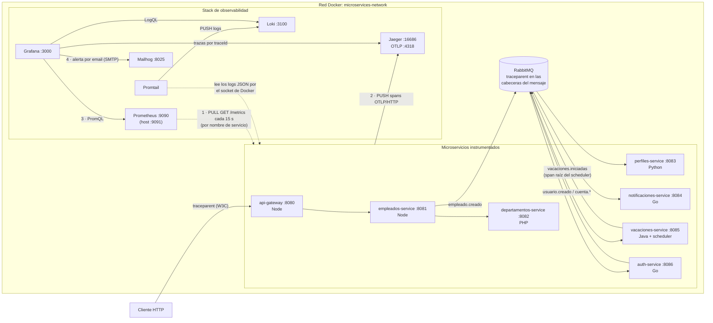

# Reto 8 — Arquitectura de observabilidad

Diagrama previo a la implementación (paso 1 del PDF). Responde las cuatro preguntas que pide: qué componentes se levantan, cómo llega Prometheus a cada servicio, cómo viajan las trazas y cómo Grafana consume los datos. Las decisiones están en [`PLAN.md`](PLAN.md).

| Pregunta del PDF | Respuesta |
|---|---|
| 1. ¿Qué componentes se levantan? | Prometheus, Grafana, Loki, Promtail y Jaeger, como servicios del mismo `docker-compose.yml`. Mailhog ya existía (Reto 4) y es el canal de las alertas |
| 2. ¿Cómo se conecta Prometheus a cada servicio? | Está en la misma red `microservices-network` y hace *scraping* (modelo **pull**) a `http://<nombre-del-servicio>:<puerto>/metrics` cada 15 s. Usa los nombres de Docker, nunca IPs ni `localhost`. El Gateway es el primer `scrape_job` |
| 3. ¿Cómo fluyen las trazas? | Cada servicio, con el SDK de OpenTelemetry, **envía** (modelo **push**) sus spans a `http://jaeger:4318` por OTLP. El `traceId` viaja entre servicios en la cabecera `traceparent` (W3C Trace Context), por HTTP y dentro de los mensajes de RabbitMQ |
| 4. ¿Cómo consume Grafana los datos? | Con fuentes de datos aprovisionadas desde archivos: consulta métricas a Prometheus (PromQL), logs a Loki (LogQL) y trazas a Jaeger. Evalúa las reglas de alerta y notifica por email a Mailhog |
