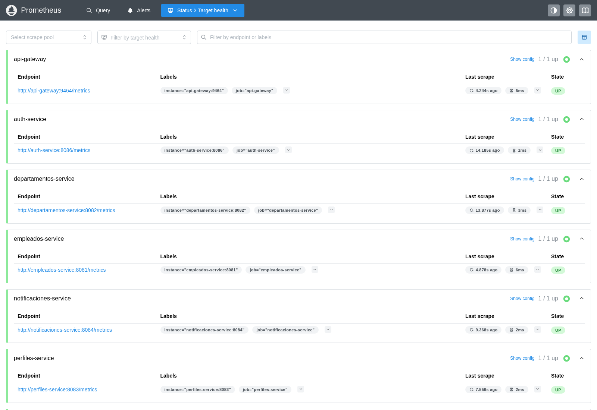
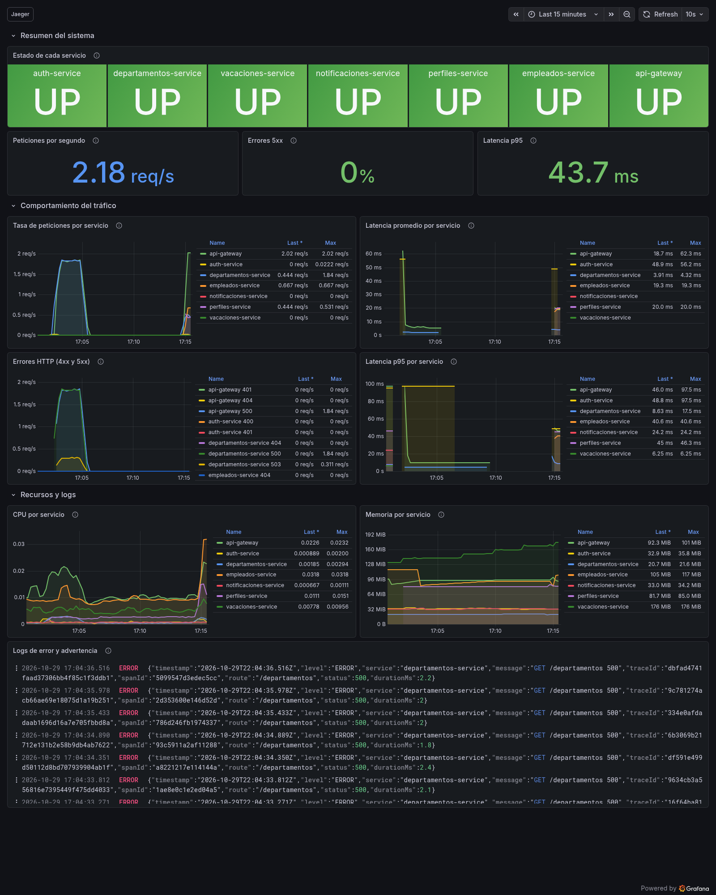
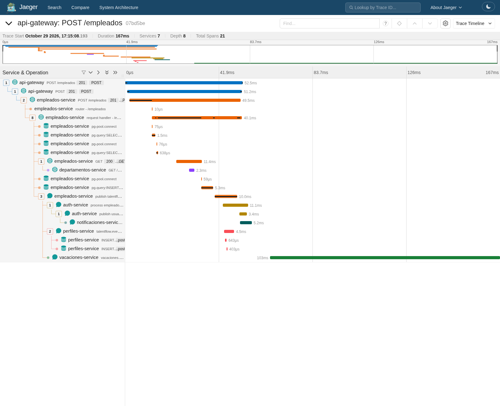
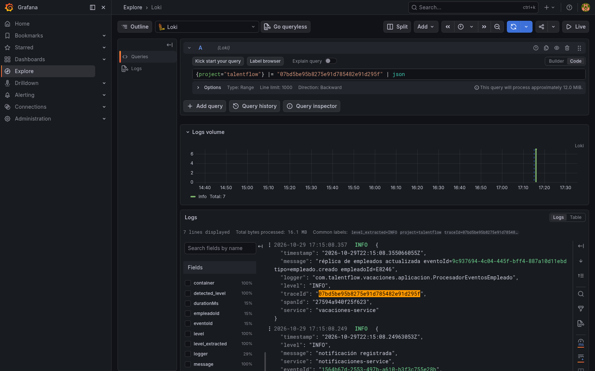
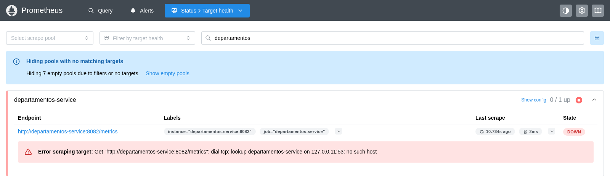
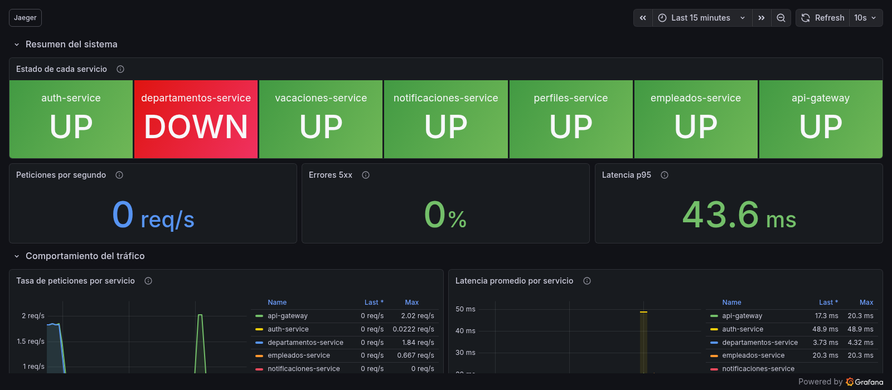
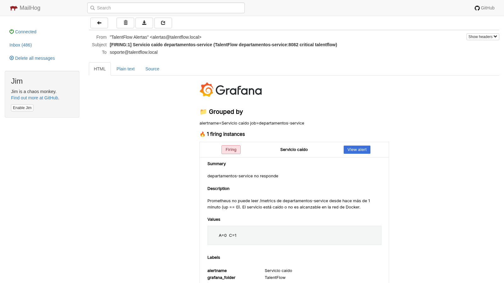
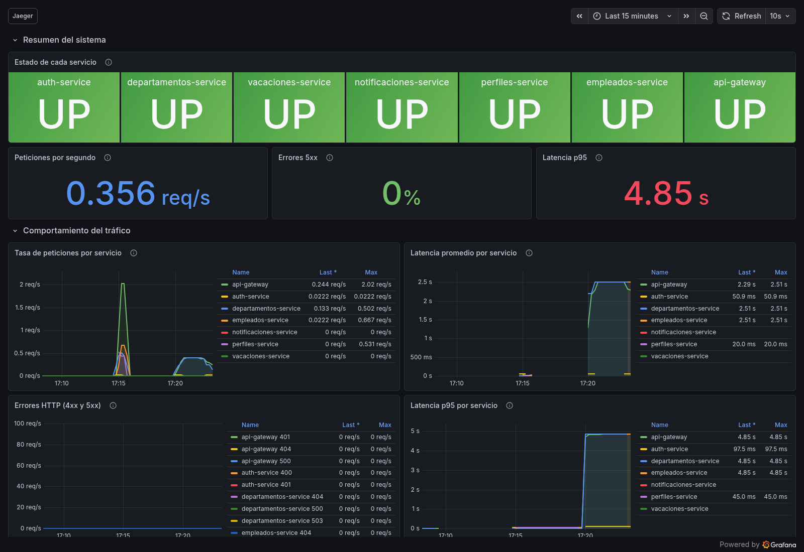
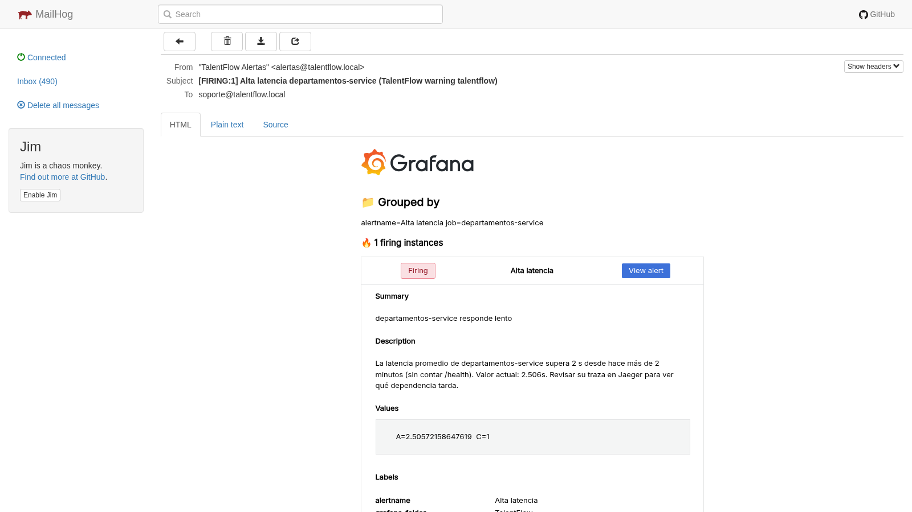
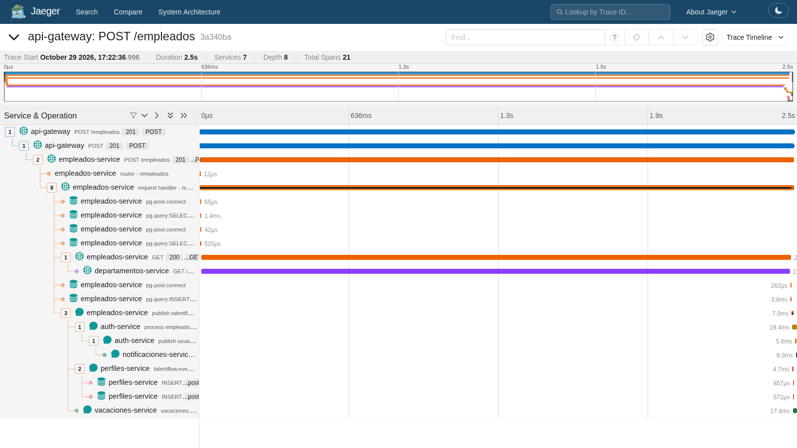

# Reto 8 — Evidencia

Cada sección dice qué se comprobó, cómo y qué salió. Las salidas y las 10 capturas son reales, del 2026-10-29, con el sistema levantado con `docker compose up -d` (los 7 microservicios más Prometheus, Grafana, Loki, Promtail y Jaeger). Las decisiones están en [`PLAN.md`](PLAN.md).

## 1. Los 7 servicios están en Prometheus (paso 2 del PDF)

`http://localhost:9091/targets`: los 7 `scrape_job` en `UP`. El Gateway publica sus métricas en el puerto interno 9464 (D13) y vacaciones en `/actuator/prometheus`.



## 2. Dashboard con métricas reales (paso 2)

Tráfico real por el Gateway: tres tandas de 10 consultas a empleados, departamentos y perfiles, más la creación de un empleado. El dashboard *TalentFlow - Observabilidad* lo carga Grafana solo, desde `observability/grafana/dashboards/talentflow.json`.



## 3. Traza distribuida de la creación de un empleado (pasos 3 y 4)

`POST /empleados` por el Gateway (201). Jaeger muestra **una sola traza con los 7 servicios y 21 spans**, con la cascada que pide el PDF: Gateway → empleados → departamentos → RabbitMQ → auth → notificaciones, más perfiles y vacaciones.



| Span | Servicio | Duración |
|---|---|---|
| `POST /empleados` (entrada) | api-gateway | 52,5 ms |
| `POST /empleados` | empleados-service | 49,5 ms |
| `GET /departamentos/{id}` (llamada HTTP) | empleados-service → departamentos-service | 11,4 ms (departamentos: 2,3 ms) |
| Consultas e `INSERT` en Postgres | empleados-service | 1,5 + 0,6 + 5,3 ms |
| `publish empleado.creado` | empleados-service | 10,0 ms |
| `process empleado.creado` → `publish usuario.creado` | auth-service | 11,1 ms (publicar: 3,4 ms) |
| `process usuario.creado` | notificaciones-service | 5,2 ms |
| `receive empleado.creado` | perfiles-service | 4,5 ms |
| `receive empleado.creado` | vacaciones-service | **103 ms** |

La traza dura 167 ms en total, pero el cliente recibe su 201 a los 52,5 ms: lo que pasa después del `publish` ocurre en segundo plano, en los consumidores de RabbitMQ.

## 3b. Logs de una petición en Loki (criterio 3)

En Grafana → Explore → Loki, con el `traceId` de la traza anterior: `{project="talentflow"} |= "07bd5be95b8275e91d785482e91d295f" | json`. Aparecen **7 líneas de 6 servicios** (empleados, departamentos, auth, notificaciones, perfiles y vacaciones; el Gateway no loguea las peticiones correctas), todas con el mismo `traceId`. `| json` separa los campos del log (`level`, `service`, `message`, `spanId`...).



Otras consultas, con su resultado: `{service="departamentos-service", level="ERROR"}` devolvió 304 líneas `GET /departamentos 500` de la prueba de la sección 6, y `{service="perfiles-service"} | json | message=~".*empleado.creado.*"` devolvió 91 líneas, una por cada `empleado.creado` que perfiles aplicó.

## 4. Caos 1: apagar un servicio (paso 5)

`docker compose stop departamentos-service` a las 17:16:22. La regla *Servicio caído* (`up < 1` durante 1 minuto) pasó a `Pending` a las 17:17:07 y a `Alerting` a las 17:18:07; el correo llegó a Mailhog enseguida. Al levantarlo (`docker compose start departamentos-service`) llegó el correo `[RESOLVED]`.

| Prometheus: target en `DOWN` | Grafana: el panel pasa a rojo |
|---|---|
|  |  |



## 5. Caos 2: inducir latencia (paso 6)

El PDF sugiere meter un retardo temporal en el código. Aquí quedó como un **interruptor apagado por defecto**: `index.php` de departamentos duerme `CAOS_LATENCIA_MS` antes de responder (no en `/health`, para que Docker no dé el contenedor por caído), y solo se enciende con `docker-compose.caos.yml` (2,5 s, por encima del umbral de 2 s y por debajo del timeout de 5 s con que empleados llama a departamentos). Así la prueba se repite sin editar ni reconstruir nada:

```bash
docker compose -f docker-compose.yml -f docker-compose.caos.yml up -d departamentos-service   # encender
docker compose up -d departamentos-service                                                     # apagar
```

Con el caos encendido (17:19:44), un `GET /departamentos` tardó 2,51 s y se mantuvo tráfico continuo. La regla *Alta latencia* (promedio mayor a 2 s durante 2 minutos) pasó a `Pending` a las 17:20:20 y a `Alerting` a las 17:22:22, para **departamentos-service y para api-gateway** (que espera a departamentos). El correo informa el valor medido: 2,506 s.





El p95 del dashboard marca 4,85 s aunque el retardo real es 2,5 s: Prometheus estima los percentiles interpolando dentro de los buckets del histograma, y 2,5 s cae en el bucket de 2 a 5 s. El promedio (`_sum / _count`, el de la alerta) sí da el valor exacto. Por eso la alerta usa el promedio, como pide el PDF.

Crear un empleado con el caos encendido tardó 2,53 s:



| Span | Servicio | Duración |
|---|---|---|
| `POST /empleados` | api-gateway | 2532 ms |
| `POST /empleados` | empleados-service | 2529 ms |
| `GET /departamentos/{id}` (llamada HTTP) | empleados-service | 2510 ms |
| `GET /departamentos/{id}` | departamentos-service | ≈ 2500 ms |

## 6. Tasa de errores 5xx (F10)

Con la base de datos de departamentos apagada (`docker stop db-departamentos`, 17:01:51) y tráfico a `GET /departamentos` (cada uno responde 500), a las 17:04:37 llegaron dos correos `[FIRING:1] Alta tasa de errores 5xx`: uno de departamentos-service y otro de api-gateway, que reenvía esos 500. Al encender la base de datos, el servicio volvió a responder 200.

## 7. ¿Qué servicio del ecosistema tardó más en responder y cómo lo identificaron?

**En condiciones normales**, dentro de la respuesta que espera el cliente, el que más tarda es **empleados-service**: 49,5 de los 52,5 ms que mide el Gateway. Abriendo su span en Jaeger, ese tiempo se reparte entre la llamada a departamentos (11,4 ms, de los que departamentos solo usa 2,3 ms: el resto es la red y el *circuit breaker*), las consultas a Postgres (≈ 7 ms) y la publicación del evento con confirmación del broker (10 ms). El span más largo de toda la traza es el de **vacaciones-service** al consumir `empleado.creado` (103 ms), pero ocurre en segundo plano y no retrasa la respuesta al cliente.

**Con el caos de latencia**, el responsable es **departamentos-service**: de los 2532 ms de la petición, 2510 ms son la espera de empleados a departamentos. Gateway y empleados aparecen lentos solo porque lo esperan.

**Cómo se identificó**, en tres pasos que se confirman entre sí:

1. **Alerta (Mailhog)**: llegó *Alta latencia* de departamentos-service y de api-gateway, pero no de empleados, que tarda lo mismo. La razón es que empleados solo recibe tráfico al crear empleados, y su promedio de 2 minutos no superó el umbral.
2. **Métricas (Grafana)**: el panel *Latencia promedio por servicio* muestra a departamentos en 2,51 s y al resto de servicios en milisegundos, salvo los que lo llaman.
3. **Trazas (Jaeger)**: en la línea de tiempo de la traza, la barra de departamentos ocupa casi todo el ancho y queda dentro de las de empleados y el Gateway. Como el span hijo dura casi lo mismo que sus padres, el tiempo se gasta en departamentos y no en quien lo llama.

Las métricas avisan que algo está lento y en qué servicio. La traza explica por qué: muestra quién espera a quién.

## 8. Regresión

Después de todos los cambios del reto, las pruebas de cada servicio siguen en verde con la lógica de negocio al 100 % (Gateway 150, empleados 92, auth y notificaciones con su umbral de Go, perfiles 37, vacaciones `mvn verify`, departamentos `test_metricas.php` y `test_trazas.php`) y la suite E2E del Reto 6 pasa **61/61** con el interruptor de caos apagado.
